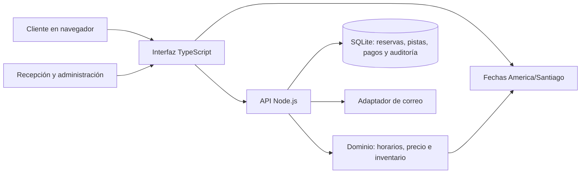

# Diseño del sistema — Bowling Smart Booking Engine

**Estado:** diseño actual del MVP, con límites de evolución
**Fecha:** 2026-10-24
**ADRs relacionados:** [0001 — stack y límites arquitectónicos](../decisions/0001-mvp-stack.md), [0002 — ciclo de reservas y datos de demo](../decisions/0002-reservation-and-demo-boundaries.md), [0003 — estrategia de pruebas](../decisions/0003-testing-strategy.md), [0004 — dominio, casos de uso y UX](../decisions/0004-domain-use-cases-and-ux.md), [0005 — portales separados para el personal](../decisions/0005-separate-staff-portals.md), [0006 — jornada operativa y cierres nocturnos](../decisions/0006-overnight-operating-hours.md)

## Objetivo y alcance

El MVP permite consultar horarios, solicitar reservas y operar el inventario de doce pistas en una sede. La web pública, la recepción y la administración comparten la misma API y el mismo inventario SQLite. La aplicación no cobra pagos ni confirma entrega de correo por sí sola.

Este documento describe lo que existe y una dirección de refactor gradual. No declara implementadas funciones que el README mantiene como pendientes.

## Contexto y componentes



En desarrollo, Vite sirve la interfaz y reenvía `/api` al servidor. En producción, el proceso Node sirve la interfaz compilada y la API. El MVP soporta una sede, una base SQLite y un proceso API. Para varios procesos se necesita coordinación externa para la cola de correo y se debe revisar ADR 0001.

La UI ofrece tres puntos de entrada: reservas públicas en `/`, recepción en `/recepcion` y administración en `/admin`. No hay un enlace desde el flujo público hacia los portales internos. Son rutas de interfaz; cada operación protegida sigue verificando sesión y rol en la API. Al montar la aplicación bajo un prefijo, las rutas internas conservan ese prefijo. Esta separación sigue [ADR 0005](../decisions/0005-separate-staff-portals.md).

## Responsabilidad por módulo

| Módulo                           | Responsabilidad actual                                                                                                                                   | Límite que debe conservarse                                                                                                                                                                              |
| -------------------------------- | -------------------------------------------------------------------------------------------------------------------------------------------------------- | -------------------------------------------------------------------------------------------------------------------------------------------------------------------------------------------------------- |
| `apps/website/shared/time.mjs`   | Conversión y formato de fechas en `America/Santiago`; rechazo de horas inexistentes por DST.                                                             | Funciones deterministas, sin DOM, HTTP ni acceso a SQLite. Se comparte entre navegador y servidor.                                                                                                       |
| `apps/website/server/domain.mjs` | Capacidad, agrupación física, tarifas, disponibilidad, alternativas y asignación.                                                                        | No importar la interfaz ni realizar I/O. Todas las decisiones comerciales de disponibilidad se validan aquí.                                                                                             |
| `apps/website/server/db.mjs`     | Esquema, migraciones, persistencia y fixtures exclusivos de demo.                                                                                        | SQLite es la fuente única de inventario; pruebas usan bases temporales.                                                                                                                                  |
| `apps/website/server/index.mjs`  | Rutas HTTP, autorización, coordinación de flujos, transacciones, auditoría y correo. El tablero incluye los límites horarios calculados por el servidor. | Es la frontera de entrada actual; mantener autorización y transacciones de inventario en servidor. Es grande y combina adaptadores HTTP con casos de uso, por lo que se extraerá gradualmente por flujo. |
| `apps/website/src/calendar.ts`   | Cálculos puros de navegación, escala, selección de intervalos y comparación con el horario operativo entregado por la API.                               | No contiene acceso a red ni manipulación del DOM; se prueba como lógica de presentación y no interpreta horarios comerciales por segunda vez.                                                            |
| `apps/website/src/main.ts`       | Renderizado HTML, estado de pantalla, eventos, formularios y llamadas a la API.                                                                          | La UX y el estado de pantalla pertenecen al cliente; no duplicar reglas comerciales. Aún reúne varias vistas, por lo que conviene separarlas por flujo conservando contratos y pruebas E2E.              |

La extracción inicial de tiempo y cálculos del calendario reduce duplicación comprobable. La API calcula el rango permitido y la interfaz usa ese rango para responder al clic sin mantener una segunda copia de las reglas semanales. No es una reescritura de la interfaz ni de la API. Los límites y el orden sugerido de futuras extracciones están registrados en [ADR 0004](../decisions/0004-domain-use-cases-and-ux.md).

## Flujos y consistencia

### Reserva web

```mermaid
sequenceDiagram
  actor Cliente
  participant UI as Interfaz
  participant API as API
  participant Dominio
  participant DB as SQLite
  Cliente->>UI: Buscar fecha, hora, duración y jugadores
  UI->>API: Consultar alternativas
  API->>Dominio: Calcular disponibilidad y cotización
  Dominio-->>API: Alternativas deterministas
  API-->>UI: Horarios y precios
  Cliente->>UI: Elegir opción y verificar correo
  UI->>API: Crear solicitud con prueba e idempotencia
  API->>DB: BEGIN IMMEDIATE; volver a validar y asignar
  DB-->>API: Compromiso único o conflicto
  API-->>UI: Solicitud retenida o alternativa de reintento
```

La consulta no reserva capacidad. La escritura vuelve a comprobar precio y disponibilidad dentro de una transacción; una prueba de correo no es una reserva. La clave de idempotencia evita duplicar solicitudes en reintentos. La API conserva separados el estado comercial, el inventario y las finanzas, según ADR 0002.

### Recepción

La recepción consulta el mismo inventario. Un clic o activación por teclado en una franja del calendario precarga fecha y hora en el formulario manual. El tablero entrega los límites horarios al navegador para la respuesta inmediata de UX. Al guardar, la API vuelve a validar horario, precio, capacidad y asignación; la selección visual nunca compromete una pista por sí misma.

## Datos y fronteras de confianza

- SQLite contiene pistas, reservas, solicitudes, asignaciones, bloqueos, pagos, sesiones, correos pendientes y auditoría.
- Los navegadores reciben vistas de datos preparadas por la API; la autorización se verifica en servidor por rol.
- La ruta `/admin` muestra la administración solo a sesiones con rol `admin`; una cuenta de recepción no carga sus datos. Las comprobaciones de la API siguen siendo obligatorias aunque la ruta de interfaz se conozca.
- Las sesiones y enlaces se basan en tokens no predecibles. Los datos de cliente no se incluyen en logs salvo los mensajes de desarrollo previstos.
- Las fixtures sintéticas se insertan una vez solo en modo demo, usan dominios `.test` y precios/hora de ejemplo. Las pruebas API y navegador usan una base temporal que se elimina al terminar.
- Un pago informado no es acreditado; no existe una pasarela. La entrega productiva de correo requiere un proveedor y secretos configurados fuera de Git.

## Tiempo, inventario y concurrencia

- La sede opera en `America/Santiago`; fechas del negocio se interpretan con la zona horaria del establecimiento, no con la del navegador o del servidor.
- Las horas inexistentes durante el salto DST se rechazan. Cuando el reloj repite una hora, el conversor común selecciona el primer instante; el buscador del dominio puede exponer ambas opciones distinguibles.
- El horario semanal pertenece al día en que abre el local. Si el viernes abre 15:00–01:00, esa jornada termina el sábado a la 01:00; una reserva que comienza el sábado antes de esa hora se valida contra la jornada del viernes, aunque el sábado esté marcado cerrado. La disponibilidad pública se consulta por la fecha civil local en que comienza la reserva.
- El margen de cierre se resta del último término permitido. Con cierre a la 01:00 y margen de 30 minutos, una sesión debe terminar a más tardar a las 00:30. Para admitir una sesión de una hora que comienza a las 00:00, el margen debe ser cero.
- El tablero de recepción muestra el intervalo completo de la jornada seleccionada y puede cruzar medianoche; los intervalos del día civil siguen resolviéndose con reglas de `America/Santiago`, incluso si duran 23 o 25 horas.
- El dominio representa parejas y agrupación física explícitamente. No se sustituye su criterio por la primera pista libre.
- Los cambios que ocupan pistas usan transacciones `BEGIN IMMEDIATE`, idempotencia y restricciones de SQLite para evitar asignaciones incompatibles.

## Diseño de pruebas y calidad

La estrategia operativa está en [Testing strategy](../testing/strategy.md). La suite por capas actualmente cubre:

1. **Unidad de dominio y tiempo:** calendario local, DST, reglas de capacidad, tarifas, agrupación y disponibilidad; escenarios sintéticos comparan la preservación de capacidad del motor con políticas simples para grupos de 4–72 personas.
2. **Unidad de presentación:** cálculos puros del calendario que no requieren DOM.
3. **Integración API:** SQLite aislado, autenticación, roles, idempotencia, concurrencia, pago manual, bloqueos y reorganización localizada con reserva fijada y rollback atómico.
4. **E2E navegador:** verificación de correo local, aprobación de grupo, recotización y aceptación, renovación/cancelación, reserva presencial/check-in/extensión, calendario por teclado y móvil. axe cubre siete estados y el reflow se revisa en 320–428, 768 y 1024 px.
5. **Smoke:** tres recorridos de entrada pública y calendario, en Vite de desarrollo y contra el artefacto compilado servido localmente por Node. No hay smoke de URL desplegada hasta configurar hosting.

La cobertura dirigida disponible es 88.07% de líneas, 83.04% de ramas y 95.35% de funciones para dominio/tiempo; `calendar.ts` registra 100% en las tres métricas. No hay una cifra global porque la API HTTP y las vistas no están instrumentadas en estos reportes. No se fija un umbral global hasta tener esa línea base. axe automatiza criterios WCAG en los estados indicados; no reemplaza una revisión manual con teclado y lector de pantalla ni cubre todos los estados.

La jornada comparativa reproducible se ejecuta con `pnpm exec vp run simulate:engine`. Sus importes usan una tarifa sintética y sus perfiles de capacidad se miden por separado; los resultados muestran compromisos entre volumen de venta y cercanía, no una predicción comercial.

## Despliegue y operación

La producción empieza cerrada si no hay horarios, tarifas, cuenta de administración, secreto estable, almacenamiento persistente y proveedor de correo. La vista previa debe utilizar datos sintéticos y nunca mandar pagos ni correos reales. Actualmente no hay pipeline de despliegue automático: el workflow de calidad ejecuta checks, pruebas, E2E y smoke del artefacto compilado, pero no publica.

## Evolución incremental

1. Mantener el dominio comprobable sin UI y añadir reglas a sus pruebas al cerrar pendientes del producto.
2. Extraer de `main.ts` una vista por flujo cuando permita reducir acoplamiento y quede cubierta por pruebas de navegador; mantener en módulos puros la lógica visual determinista.
3. Extraer casos de uso de `index.mjs` cuando una ruta crezca o se comparta lógica. Dejar adaptadores HTTP enfocados en parsear/validar/enviar respuestas y conservar las transacciones del dominio en el servidor.
4. Reconsiderar base de datos o cola distribuida solo al requerir varias instancias, sedes o carga que exceda el proceso actual; registrar la decisión en un ADR.

## Límites conocidos

- La interfaz principal todavía mantiene varias vistas y su estado en `main.ts`; la separación actual es incremental.
- E2E ya cubre aprobación, cambio y aceptación de precio, renovación/cancelación, reserva presencial, check-in y extensión. Aún faltan flujos de modificación, abuso, incidencias de pista y pagos más completos descritos en la especificación.
- La estrategia local no verifica una URL desplegada; tampoco hay pruebas manuales con lector de pantalla o instrumentación global de cobertura.
- El optimizador es una heurística determinista acotada; no prueba un óptimo global.
- No se ejecutan cobros ni devoluciones y no se automatizan políticas comerciales aún no definidas.
