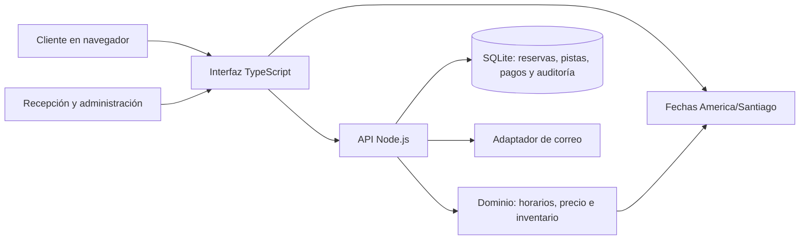

# Diseño del sistema — Bowling Smart Booking Engine

**Estado:** diseño actual del MVP, con límites de evolución
**Fecha:** 2026-10-24
**ADRs relacionados:** [0001 — stack y límites arquitectónicos](../decisions/0001-mvp-stack.md), [0002 — ciclo de reservas y datos de demo](../decisions/0002-reservation-and-demo-boundaries.md), [0003 — estrategia de pruebas](../decisions/0003-testing-strategy.md)

## Objetivo y alcance

El MVP permite consultar horarios, solicitar reservas y operar el inventario de doce pistas en una sede. La web pública, la recepción y la administración comparten la misma API y el mismo inventario SQLite. La aplicación no cobra pagos ni confirma entrega de correo por sí sola.

Este documento describe lo que existe y una dirección de refactor gradual. No declara implementadas funciones que el README mantiene como pendientes.

## Contexto y componentes



En desarrollo, Vite sirve la interfaz y reenvía `/api` al servidor. En producción, el proceso Node sirve la interfaz compilada y la API. El MVP soporta una sede, una base SQLite y un proceso API. Para varios procesos se necesita coordinación externa para la cola de correo y se debe revisar ADR 0001.

## Responsabilidad por módulo

| Módulo                           | Responsabilidad actual                                                                                                                                   | Límite que debe conservarse                                                                                                                                                                   |
| -------------------------------- | -------------------------------------------------------------------------------------------------------------------------------------------------------- | --------------------------------------------------------------------------------------------------------------------------------------------------------------------------------------------- |
| `apps/website/shared/time.mjs`   | Conversión y formato de fechas en `America/Santiago`; rechazo de horas inexistentes por DST.                                                             | Funciones deterministas, sin DOM, HTTP ni acceso a SQLite. Se comparte entre navegador y servidor.                                                                                            |
| `apps/website/server/domain.mjs` | Capacidad, agrupación física, tarifas, disponibilidad, alternativas y asignación.                                                                        | No importar la interfaz ni realizar I/O. Todas las decisiones comerciales de disponibilidad se validan aquí.                                                                                  |
| `apps/website/server/db.mjs`     | Esquema, migraciones, persistencia y fixtures exclusivos de demo.                                                                                        | SQLite es la fuente única de inventario; pruebas usan bases temporales.                                                                                                                       |
| `apps/website/server/index.mjs`  | Rutas HTTP, autorización, coordinación de flujos, transacciones, auditoría y correo. El tablero incluye los límites horarios calculados por el servidor. | Es la frontera de entrada; mantener las transacciones de inventario y controles de acceso en el servidor. Su tamaño hace que sea el principal candidato a extracción futura por casos de uso. |
| `apps/website/src/calendar.ts`   | Cálculos puros de navegación, escala, selección de intervalos y comparación con el horario operativo entregado por la API.                               | No contiene acceso a red ni manipulación del DOM; se prueba como lógica de presentación y no interpreta horarios comerciales por segunda vez.                                                 |
| `apps/website/src/main.ts`       | Renderizado HTML, estado de pantalla, eventos, formularios y llamadas a la API.                                                                          | UX y estado visual permanecen aquí; las reglas de reserva y disponibilidad no se duplican en el navegador. Conviene separar vistas por flujo cuando haya cobertura E2E suficiente.            |

La extracción inicial de tiempo y cálculos del calendario reduce duplicación comprobable. La API calcula el rango permitido y la interfaz usa ese rango para responder al clic sin mantener una segunda copia de las reglas semanales. No es una reescritura de la interfaz ni de la API.

## Flujos y consistencia

### Reserva web

```mermaid
sequenceDiagram
  actor Cliente
  participant UI as Interfaz
  participant API as API
  participant Dominio
  participant DB as SQLite
  Cliente->>UI: Buscar fecha, hora, duración y jugadores
  UI->>API: Consultar alternativas
  API->>Dominio: Calcular disponibilidad y cotización
  Dominio-->>API: Alternativas deterministas
  API-->>UI: Horarios y precios
  Cliente->>UI: Elegir opción y verificar correo
  UI->>API: Crear solicitud con prueba e idempotencia
  API->>DB: BEGIN IMMEDIATE; volver a validar y asignar
  DB-->>API: Compromiso único o conflicto
  API-->>UI: Solicitud retenida o alternativa de reintento
```

La consulta no reserva capacidad. La escritura vuelve a comprobar precio y disponibilidad dentro de una transacción; una prueba de correo no es una reserva. La clave de idempotencia evita duplicar solicitudes en reintentos. La API conserva separados el estado comercial, el inventario y las finanzas, según ADR 0002.

### Recepción

La recepción consulta el mismo inventario. Un clic o activación por teclado en una franja del calendario precarga fecha y hora en el formulario manual. El tablero entrega los límites horarios al navegador para la respuesta inmediata de UX. Al guardar, la API vuelve a validar horario, precio, capacidad y asignación; la selección visual nunca compromete una pista por sí misma.

## Datos y fronteras de confianza

- SQLite contiene pistas, reservas, solicitudes, asignaciones, bloqueos, pagos, sesiones, correos pendientes y auditoría.
- Los navegadores reciben vistas de datos preparadas por la API; la autorización se verifica en servidor por rol.
- Las sesiones y enlaces se basan en tokens no predecibles. Los datos de cliente no se incluyen en logs salvo los mensajes de desarrollo previstos.
- Las fixtures sintéticas se insertan una vez solo en modo demo, usan dominios `.test` y precios/hora de ejemplo. Las pruebas API y navegador usan una base temporal que se elimina al terminar.
- Un pago informado no es acreditado; no existe una pasarela. La entrega productiva de correo requiere un proveedor y secretos configurados fuera de Git.

## Tiempo, inventario y concurrencia

- La sede opera en `America/Santiago`; fechas del negocio se interpretan con la zona horaria del establecimiento, no con la del navegador o del servidor.
- Las horas inexistentes durante el salto DST se rechazan. Cuando el reloj repite una hora, el conversor común selecciona el primer instante; el buscador del dominio puede exponer ambas opciones distinguibles.
- El tablero muestra el horario de atención y puede cruzar medianoche. La duración de un día civil puede ser 23, 24 o 25 horas.
- El dominio representa parejas y agrupación física explícitamente. No se sustituye su criterio por la primera pista libre.
- Los cambios que ocupan pistas usan transacciones `BEGIN IMMEDIATE`, idempotencia y restricciones de SQLite para evitar asignaciones incompatibles.

## Diseño de pruebas y calidad

La estrategia operativa está en [Testing strategy](../testing/strategy.md). La suite por capas actualmente cubre:

1. **Unidad de dominio y tiempo:** calendario local, DST, reglas de capacidad, tarifas, agrupación y disponibilidad.
2. **Unidad de presentación:** cálculos puros del calendario que no requieren DOM.
3. **Integración API:** SQLite aislado, autenticación, roles, idempotencia, concurrencia, pago manual y bloqueos.
4. **E2E navegador:** verificación de correo simulada, solicitud de grupo, aprobación y seguimiento; reserva presencial/check-in; calendario por teclado y móvil; disposición tablet/laptop; axe para entrada pública y tablero.
5. **Smoke:** carga pública, navegación/zoom/teclado del calendario y desplazamiento a 390 px. No hay smoke de vista previa hasta configurar hosting.

La cobertura dirigida disponible es 88.07% de líneas, 81.76% de ramas y 95.35% de funciones para dominio/tiempo; `calendar.ts` registra 100% en las tres métricas. No hay una cifra global porque la API HTTP y las vistas no están instrumentadas en estos reportes. No se fija un umbral global hasta tener esa línea base. axe automatiza criterios WCAG en dos pantallas; no reemplaza una revisión manual con teclado y lector de pantalla ni cubre todos los estados.

## Despliegue y operación

La producción empieza cerrada si no hay horarios, tarifas, cuenta de administración, secreto estable, almacenamiento persistente y proveedor de correo. La vista previa debe utilizar datos sintéticos y nunca mandar pagos ni correos reales. Actualmente no hay pipeline de despliegue automático: el workflow de calidad ejecuta checks, pruebas y E2E, pero no publica.

## Evolución incremental

1. Mantener el dominio comprobable sin UI y añadir reglas a sus pruebas al cerrar pendientes del producto.
2. Extraer de `main.ts` una vista por flujo cuando permita reducir acoplamiento y quede cubierta por pruebas de navegador.
3. Extraer casos de uso de `index.mjs` cuando una ruta crezca o se comparta lógica, manteniendo límites transaccionales y contratos HTTP.
4. Reconsiderar base de datos o cola distribuida solo al requerir varias instancias, sedes o carga que exceda el proceso actual; registrar la decisión en un ADR.

## Límites conocidos

- La interfaz principal todavía mantiene varias vistas y su estado en `main.ts`; la separación actual es incremental.
- E2E cubre solicitud/aprobación, reserva presencial/check-in y calendario, pero aún faltan cancelación, extensión, aceptación de precio, modales y otros anchos móviles.
- El optimizador es una heurística determinista acotada; no prueba un óptimo global.
- No se ejecutan cobros ni devoluciones y no se automatizan políticas comerciales aún no definidas.
